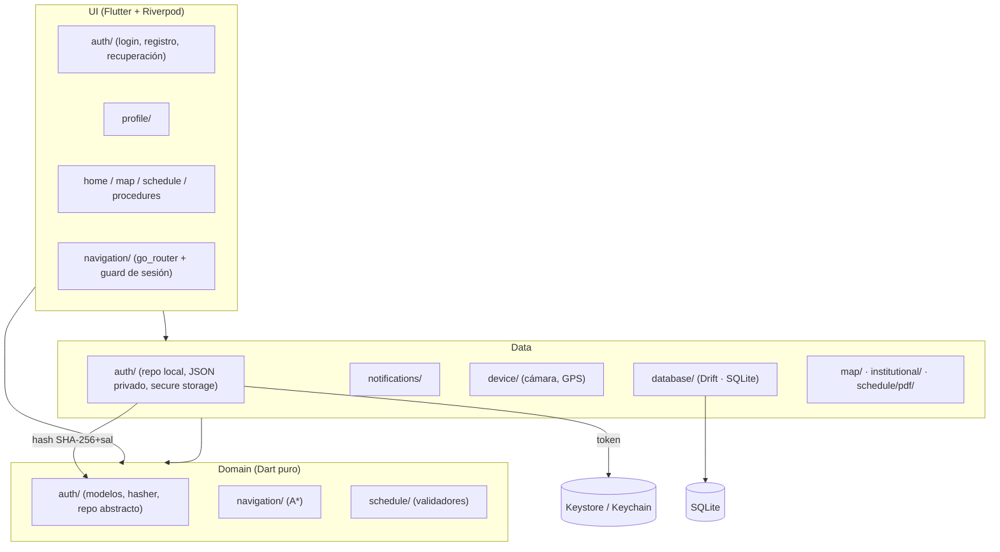
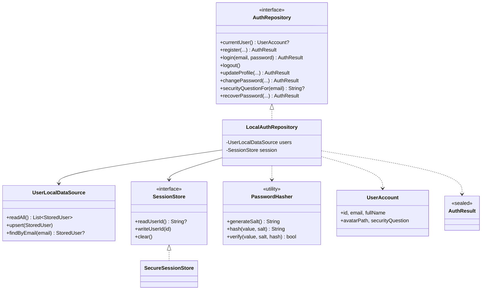
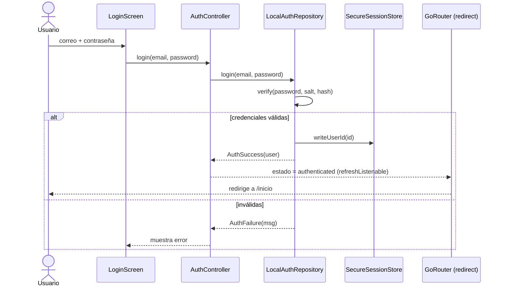
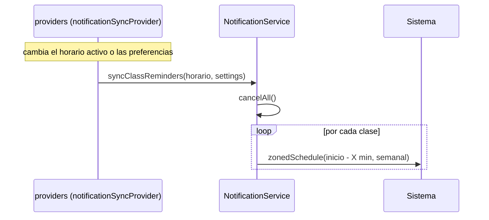

# Arquitectura y Diagramas UML — ESCOM Orienta Móviles

Diagramas de apoyo para la documentación y defensa (DAMN-20271). Se renderizan en GitHub (Mermaid).

## 1. Arquitectura por capas (Clean Architecture)

## 2. Diagrama de clases — módulo de Autenticación (RF1)

## 3. Secuencia — Inicio de sesión y guardia de navegación

## 4. Secuencia — Recordatorios de clase (RF3)

